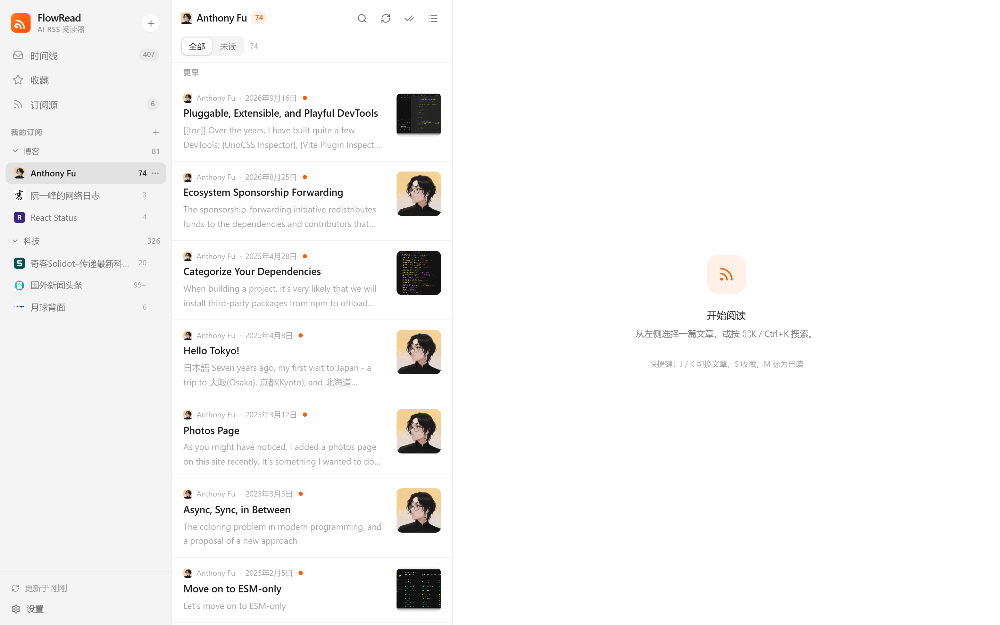
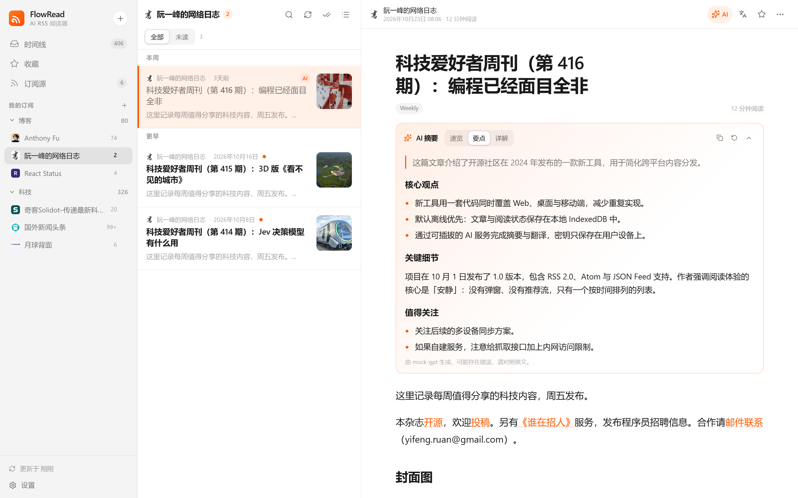
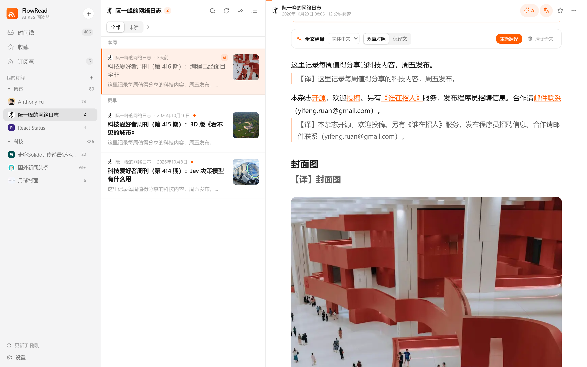
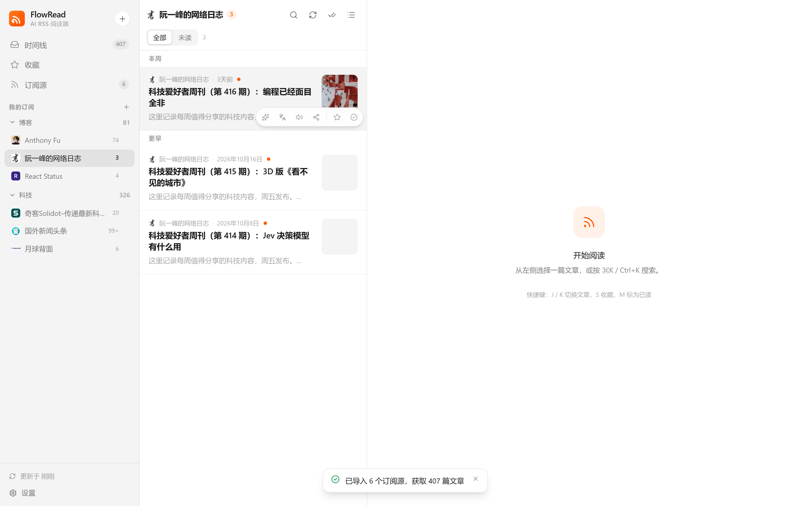
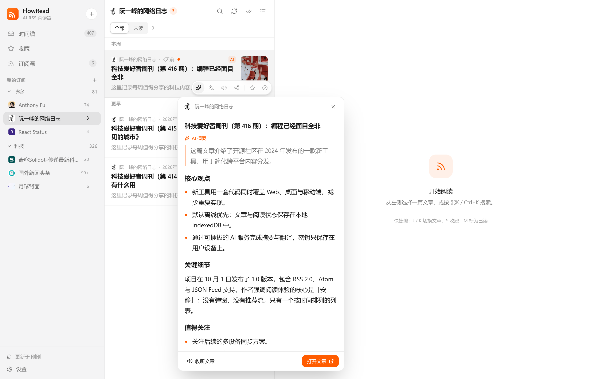
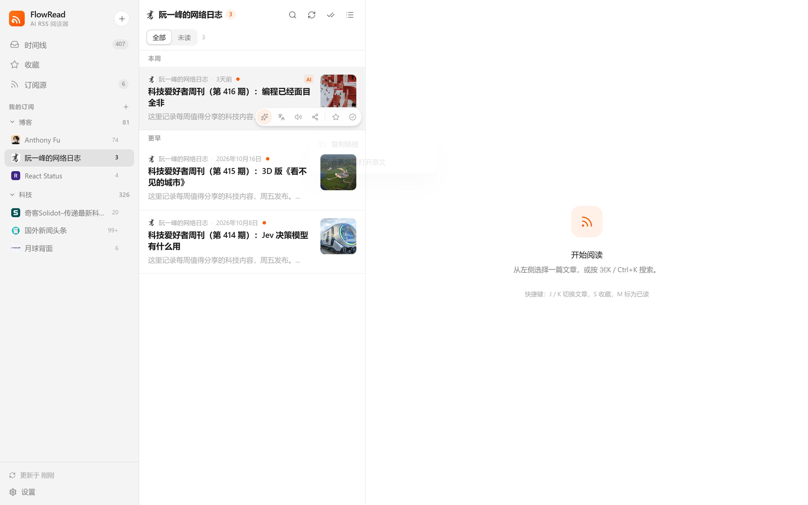
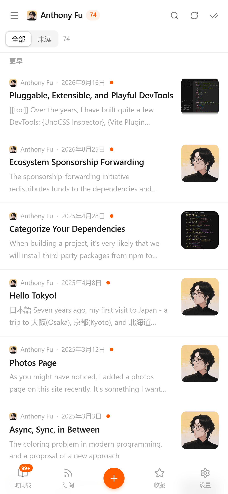
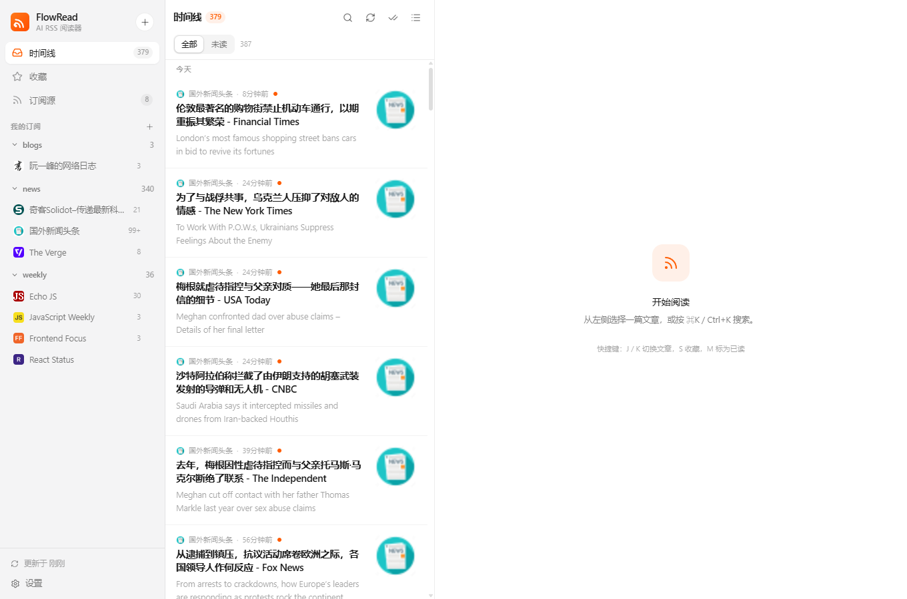
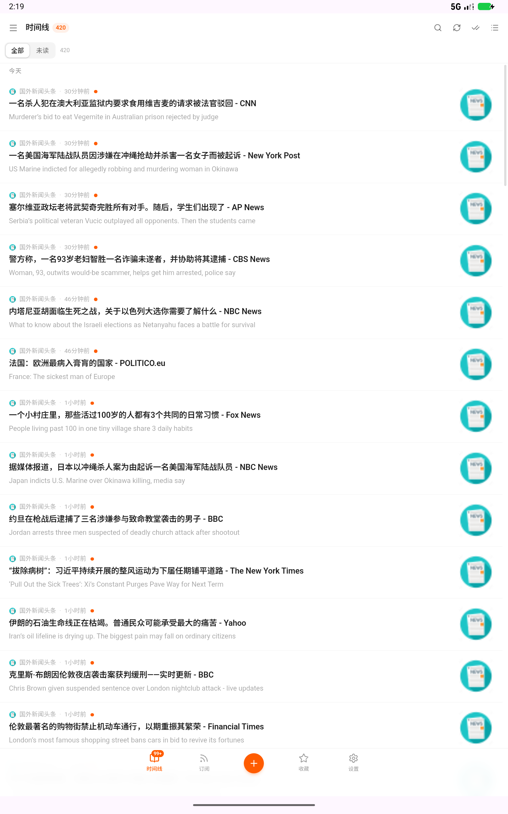

# FlowRead · 跨平台 AI RSS 阅读器

FlowRead 是一个以「安静阅读」为核心的 RSS 阅读器：网页、Android 与 Windows 桌面端共用一套界面与数据模型，内置 **AI 摘要**、**全文翻译（双语对照）**、**朗读** 与本地优先的离线阅读。

桌面端与 Android 端均使用 **Tauri（Rust + WebView）**，订阅源、文章、设置与 AI Key 保存在本地 **SQLite**；网页端继续使用 Hono 服务端 + IndexedDB，保证浏览器里也能直接使用。

界面参考 [Folo](https://app.folo.is)：三栏时间线、暖橙色强调色、宽松的中英混排排版，以及鼠标悬停即可操作的文章卡片。



## 功能

- **多格式订阅**：RSS 2.0、RSS 1.0、Atom、JSON Feed；输入网站首页即可自动发现订阅源。
- **悬停操作栏**：鼠标移到文章卡片上显示「摘要 / 翻译 / 收听 / 分享 / 收藏 / 已读」，不用先打开文章。
- **AI 摘要悬停卡片**：点摘要按钮弹出 Folo 风格预览卡，流式生成摘要、可继续收听或打开全文。
- **AI 摘要**：速览 / 要点 / 详解三种模式，流式输出、可停止、结果本地缓存。
- **全文翻译**：悬停点翻译会打开文章并自动开始全文翻译，支持「双语对照 / 仅译文」、多目标语言，译文按语言缓存。
- **收听文章**：基于 Web Speech API 分句朗读，可随时停止；摘要卡片与操作栏均可触发。
- **分享帖子**：一键复制链接，或在系统浏览器 / 新窗口打开原文。
- **订阅管理**：右键（触屏用「…」按钮）**编辑订阅**（名称 / 订阅地址 / 分组 / 代理）、刷新、全部已读、移动分组、复制链接、删除；修改订阅地址时先抓取验证，成功后才保存并合并新文章。订阅源页面支持**复选框多选、全选、清空、批量移动分组、批量取消订阅**；批量取消只显示一条汇总提示，不会逐个弹出「订阅已删除」；删除/清空使用应用内确认弹窗，不显示 `tauri.localhost` 原生标题，操作通知显示在页面顶部。[多选截图](docs/screenshots/25-subscriptions-checkbox.png) · [确认弹窗](docs/screenshots/26-confirm-dialog.png) Web 与 Windows 支持拖拽手柄排序/拖到分组；Android 端不提供拖拽排序，统一通过「…」菜单管理。删除统一走右键菜单，不提供拖拽删除。
- **可收起三栏布局**：桌面端可分别收起左侧订阅栏和中间文章列表，阅读区自动占满；状态保存在本地，刷新/重启后保持。[布局截图](docs/screenshots/23-panes-hidden.png)
- **返回顶部**：文章滚动后右下角出现浮动按钮，点击平滑回到文章开头。
- **网络代理**：支持 HTTP/HTTPS 代理，可选「全部代理」或只让标记的订阅源走代理；订阅抓取与 AI 请求均生效（仅选中模式时 AI 直连）。
- **长标题查看**：Web/Windows 侧边栏订阅/分组名被省略号截断时，悬停显示完整名称的浮动提示；Android 端不显示该浮层，点击标题直接进入订阅。
- **OPML 导入校验**：导入时逐个验证订阅源，无法访问或无法解析的源直接跳过，不写入本地数据库；若本次一个都验证失败（例如服务端网络受限或内网地址被 SSRF 拦截），会弹窗询问是否仍然导入，确认后可先导入未验证源再手动刷新。重复导入不会重复添加订阅/分组，导入进行中会阻止并发导入。
- **本地存储与备份**：桌面端 SQLite、浏览器 IndexedDB；设置页显示存储占用，支持导出/导入 JSON 配置（可选包含 API Key）。
- **全文抓取**：订阅源只给摘要时自动提取原文正文，也可手动切换摘要 / 全文。
- **跨端**：Web/PWA、Tauri 桌面（Windows/macOS/Linux）、Tauri Android。

| AI 摘要 | 双语翻译 |
| --- | --- |
|  |  |

| 悬停操作栏 | 摘要悬停卡片 |
| --- | --- |
|  |  |

| 分享菜单 | 移动端 |
| --- | --- |
|  |  |

> 截图中的 AI 结果来自本地 mock 模型（只用于验证流式渲染与排版），真实效果取决于你配置的模型。

## 技术架构

```
┌────────────────────────────────────────────────────────────────────┐
│                          客户端（共享 React UI）                      │
│                                                                    │
│   Web / PWA            Tauri 桌面 / Android（Rust）                  │
│   IndexedDB            SQLite + Rust commands                       │
│        │                       │                                    │
│        │                       ├─ fetch_text（Rust HTTP，绕过 CORS） │
│        │                       ├─ ai_stream（Rust SSE → Channel）    │
│        │                       └─ SQLite（tauri-plugin-sql）         │
│        └───────────────┬───────┘                                    │
│                        │ /api/*（仅 Web）                            │
│              ┌─────────▼──────────┐                                 │
│              │  FlowRead Server   │  Hono：抓取/解析/正文提取/AI 代理 │
│              └─────────┬──────────┘                                 │
└────────────────────────┼─────────────────────────────────────────────┘
                         │
          RSS/Atom/JSON Feed · OpenAI 兼容 Chat Completions
```

- **桌面 / Android 无 Node 依赖**：Tauri 的 Rust 命令负责 HTTP 抓取、AI SSE 转发与 SQLite 存储；WebView 里运行同一套 React/TS 解析器与 UI。
- **仅 Web 需要服务端**：浏览器同源策略无法直接抓取任意 RSS，服务端负责抓取、正文提取、图片/图标代理与 AI 代理；Tauri 端全部在本地完成。
- **本地优先**：文章与阅读状态存在本机；Tauri（桌面 / Android）用 `flowread.db`（SQLite），浏览器用 IndexedDB。

## 快速开始

环境要求：Node.js ≥ 20、pnpm 10；桌面端额外需要 Rust ≥ 1.77、MSVC Build Tools 与 WebView2（Windows 10/11 通常已内置）。

```bash
pnpm install
pnpm dev          # 同时启动 API (8787) 与 Web (5173)
```

打开 http://127.0.0.1:5173 ，点击「导入 OPML」或「载入示例订阅」即可开始。导入会先验证每个订阅源，无法访问或解析失败的条目会被跳过。仓库根目录的 `feedbro-subscriptions.opml` 可以直接导入。

生产构建（单端口同时提供页面与 API）：

```bash
pnpm build
pnpm start        # 默认 http://localhost:8787
```

## 配置 AI

打开左下角 **设置 → AI 服务**：

| 服务商 | 接口地址 | 模型示例 |
| --- | --- | --- |
| DeepSeek | `https://api.deepseek.com/v1` | `deepseek-chat` |
| OpenAI | `https://api.openai.com/v1` | `gpt-4o-mini` |
| SiliconFlow | `https://api.siliconflow.cn/v1` | `Qwen/Qwen2.5-7B-Instruct` |
| Ollama（本地） | `http://127.0.0.1:11434/v1` | `qwen2.5:7b` |
| 自定义 | 任意 OpenAI Chat Completions 兼容地址 | 例如 `qwen-plus` |

- API Key 只保存在本机（Tauri → SQLite，浏览器 → IndexedDB），桌面端由 Rust 直接请求你配置的服务商，不经过任何中转服务器。
- 模型列表通过服务商官方 `/models` 接口读取：填写 API Key 后点击「获取模型」，再从下拉框选择；未填写 Key 时按钮禁用（Ollama / 自定义本地服务除外）。
- 支持「测试连接」；摘要语言可固定中文 / 英文，或跟随原文。
- 未配置 AI 时，阅读器其余功能完全可用。

## 跨端运行

### 网页 / PWA

`pnpm build` 后用 `pnpm start` 提供单端口服务，或在 `pnpm dev` 下使用 5173。支持安装为 PWA（`manifest.webmanifest` + Service Worker 离线壳）。

Docker 部署：

```bash
docker compose up -d --build
# 打开 http://<服务器地址>:8787
```

> 默认禁止抓取内网地址以防 SSRF；若确实要订阅内网 RSS，设置 `ALLOW_PRIVATE_NETWORK=1`。

### Windows 桌面版（Tauri + SQLite）



```bash
pnpm desktop:dev     # 启动 Vite + Tauri 开发窗口
pnpm desktop:pack    # 构建发布版 + Windows NSIS 安装包
```

产物：

- `apps/desktop/src-tauri/target/release/flowread.exe` — 可执行文件
- `apps/desktop/src-tauri/target/release/bundle/nsis/FlowRead_0.1.0_x64-setup.exe` — 安装包

本地数据位于应用数据目录下的 `flowread.db`（Windows 为 `%APPDATA%\is.flowread.desktop\flowread.db`），包含 `feeds`、`folders`、`articles`、`settings` 四张表；文章与 AI 结果以 JSON 列存储，便于版本演进。设置页的「服务端」区块在桌面端自动隐藏，AI 请求由 Rust 直连服务商。

安装包未做代码签名，Windows SmartScreen 可能提示「未知发布者」，选择“仍要运行”即可。

中国大陆网络若无法访问 crates.io，可使用镜像（本工作区已附带 `.cargo/config.toml`，该目录默认不提交）：

```toml
[source.crates-io]
replace-with = "rsproxy-sparse"

[source.rsproxy-sparse]
registry = "sparse+https://rsproxy.cn/index/"
```

如果 NSIS 工具下载超时，可给打包器设置 GitHub 镜像：

```powershell
$env:TAURI_BUNDLER_TOOLS_GITHUB_MIRROR="https://gh-proxy.com/https://github.com"
pnpm desktop:pack
```

### Android 版（Tauri）


Android 端与桌面端共用 Tauri Rust 命令和 SQLite，**不再依赖 Hono 服务端**，也不需要填写服务地址。已适配状态栏、导航栏与刘海安全区，平板/横屏下标题不会与系统时间重叠。Android 端不提供订阅拖拽排序，侧栏长标题也不显示悬停浮层，避免与触摸滚动/返回手势冲突。



前置环境：JDK 17+、Android SDK Platform 36、Build-Tools 36、NDK 27，以及 Rust Android targets：

```bash
rustup target add aarch64-linux-android armv7-linux-androideabi i686-linux-android x86_64-linux-android
```

```bash
pnpm android:build   # 构建 arm64-v8a + x86_64 通用 APK
adb install -r apps/desktop/src-tauri/target/release/bundle/android/FlowRead_0.1.0_universal.apk
```

`android:build` 会构建 Web、Rust 库并调用 Gradle 打包。Windows 未开启开发者模式时 Tauri CLI 无法为 `.so` 创建符号链接，该脚本会先把库复制到 `jniLibs` 再打包，因此无需开发者模式。若已开启开发者模式，也可以直接使用：

```bash
pnpm --filter @flowread/desktop exec tauri android build --apk
```

APK 使用本机 debug keystore 签名，适合本地安装测试；正式发布请替换为自己的 keystore。开发调试可使用 `pnpm android:dev`（需要 Vite 与 adb reverse）。

## 项目结构

```
.
├── apps/
│   ├── web/                 # React 19 + Vite + Tailwind v4 前端（PWA / Tauri / Android 共用）
│   ├── server/              # Hono API：抓取、解析、全文提取、AI 代理、静态托管（仅 Web）
│   ├── desktop/             # Tauri 桌面 + Android
│   │   └── src-tauri/       # Rust：fetch_text / ai_stream / SQLite 插件 / 安装包配置
│   │       └── gen/android/ # Tauri Android Gradle 工程
├── packages/
│   └── shared/              # 共用解析器、AI 提示词、OPML、类型与工具函数
├── docs/screenshots/        # 端到端截图
├── scripts/
│   ├── check-feeds.mjs      # 用真实 OPML 批量验证抓取与解析
│   ├── mock-ai.mjs          # OpenAI 兼容的本地模拟服务（测试摘要/翻译）
│   ├── build-android.mjs    # 无符号链接依赖的 Android APK 构建脚本
│   ├── screenshots.mjs      # Playwright 端到端截图
│   ├── verify-hover-actions.mjs # 悬停操作栏/摘要卡片/分享菜单
│   ├── verify-management.mjs # 编辑订阅/拖拽排序/长标题提示/无效 OPML/备份
│   ├── verify-subscriptions.mjs # 订阅复选框/全选/清空/批量移动/确认弹窗/顶部通知
│   ├── verify-layout.mjs    # 收起左右栏/返回顶部/真实鼠标拖拽/布局持久化
│   ├── verify-proxy.mjs     # 全部代理 / 仅选中订阅 / 代理设置持久化
│   ├── mock-proxy.mjs       # 本地 HTTP 代理（用于代理功能验证）
│   ├── verify-tauri.mjs     # Tauri 窗口内：Rust 抓取/AI 通道/SQLite
│   ├── fixtures/            # 测试用 OPML
│   └── make-icons.py        # 生成 PNG/ICO 图标
├── Dockerfile
├── docker-compose.yml
└── pnpm-workspace.yaml
```

## API 与桌面命令

Web 使用 `/api` 下的 HTTP 接口：

| 方法 | 路径 | 说明 |
| --- | --- | --- |
| GET | `/api/health` | 健康检查与版本 |
| POST | `/api/feed/fetch` | 抓取并解析订阅，支持 ETag 条件请求 |
| POST | `/api/feed/discover` | 从网页发现订阅源 |
| POST | `/api/article/extract` | 提取文章正文 |
| GET | `/api/icon?url=` / `/api/image?url=` | 图标 / 图片代理 |
| POST | `/api/ai/summarize` / `/api/ai/translate` | SSE 流式摘要与翻译 |
| POST | `/api/ai/models` | 通过服务商 `/models` 接口获取模型列表 |
| POST | `/api/ai/test` | 验证 AI 配置 |

桌面端通过 Tauri IPC 调用同名能力的 Rust 命令：

| 命令 | 说明 |
| --- | --- |
| `fetch_text(url, headers)` | Rust HTTP 抓取（UA、超时、重定向、字符集解码、10MB 限制） |
| `ai_stream(request, onEvent)` | 转发 OpenAI 兼容 SSE，逐块通过 Channel 推给前端 |
| `ai_cancel(id)` | 停止正在生成的摘要 / 翻译 |
| `ai_models(url, headers)` | 获取服务商模型列表（GET `/models`） |
| `ai_complete(url, headers, body)` | 非流式请求，用于「测试连接」 |

## 数据模型

桌面端 SQLite（Tauri）：

- `feeds(id, folder_id, sort_index, data JSON)`、`folders(id, data JSON)`
- `articles(id, feed_id, published_at, data JSON)` + 按订阅/发布时间索引
- `settings(key, value JSON)`

浏览器继续使用 IndexedDB（Dexie）实现同一 `LocalRepository` 接口，因此 UI 与业务逻辑完全共用。去重策略：`feedId + guid` 生成稳定 ID，并以规范化链接兜底；每个订阅最多保留 400 篇，收藏与已生成 AI 内容的文章不会被清理。

设置页的「本地备份」可以把设置、分组与订阅导出成 JSON（可选择是否包含 API Key），再在另一台设备导入；文章正文不进入备份文件。

## 验证与测试

```bash
pnpm test                 # 71 个单元测试：解析/OPML/正文提取/AI/API/代理/排序/备份
pnpm typecheck            # 5 个包的 TypeScript 检查
pnpm desktop:check        # cargo check（Rust 命令与 Tauri 配置）
node scripts/check-feeds.mjs feedbro-subscriptions.opml   # 真实订阅抓取冒烟测试
node scripts/mock-ai.mjs & node scripts/screenshots.mjs   # 端到端 UI 截图（需先启动服务）
node scripts/verify-hover-actions.mjs   # 悬停摘要/翻译/收听/分享
node scripts/verify-management.mjs      # 右键菜单/编辑订阅/拖拽排序/长标题提示/无效 OPML/备份
node scripts/verify-subscriptions.mjs   # 订阅复选框/全选/清空/批量移动/确认弹窗/顶部通知
node scripts/verify-layout.mjs          # 收起左右栏/返回顶部/真实鼠标拖拽/布局持久化
node scripts/verify-proxy.mjs           # 全部代理 / 仅选中订阅（需 mock-proxy）
node scripts/verify-tauri.mjs           # Tauri 窗口内：Rust 抓取/AI 通道/桌面端隐藏服务端配置
```

`verify-hover-actions.mjs` 会真实悬停文章卡片、打开摘要卡片、触发分享菜单与翻译跳转并截图；`verify-management.mjs` 覆盖右键编辑订阅、移动分组、拖拽排序、长标题浮动提示、无效 OPML 跳过、刷新后 AI Key 仍在、配置导出/导入；`verify-subscriptions.mjs` 验证复选框多选、全选、清空、批量移动、无原生域名的确认弹窗与顶部通知；`verify-layout.mjs` 使用真实鼠标拖拽并验证返回顶部按钮与左右栏收起状态在刷新后保持；`verify-proxy.mjs` 需要先运行 `node scripts/mock-proxy.mjs 8899`；`verify-tauri.mjs` 需要先以 `WEBVIEW2_ADDITIONAL_BROWSER_ARGUMENTS=--remote-debugging-port=9222` 启动桌面应用，并运行 mock AI。

## 安全说明

- 仅 Web 服务端默认阻止私有网段与云元数据地址（SSRF），可显式放开；Tauri 桌面 / Android 的 Rust 抓取在本机运行。
- 抓取有 30 秒超时、10 MB 大小上限与字符集嗅探（兼容 GBK 等中文站点）。
- 文章 HTML 渲染前经 DOMPurify 清洗，移除脚本、表单与内联事件。
- AI Key 只保存在本机，请勿把带 Key 的配置备份随意分享。

## 路线图

- [ ] 多设备同步（SQLite → 可选同步后端）
- [ ] 播客播放队列与章节
- [ ] 规则过滤 / 关键词高亮
- [ ] iOS 构建（Tauri iOS，需要 macOS + Xcode）
